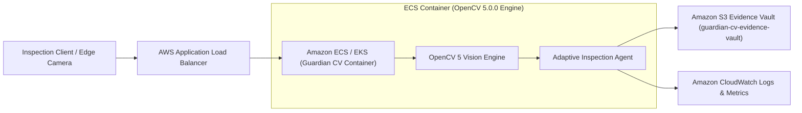

# AWS Cloud Deployment & Integration Guide
## Guardian CV — OpenCV 2026 Competition Submission

This document outlines the AWS cloud architecture, container runtime, and evidence persistence pipeline for **Guardian CV**.

---

### 1. Cloud Architecture Overview

Guardian CV deploys a hybrid cloud architecture designed for real-time edge processing or centralized AWS cloud execution on **AWS Graviton (arm64)** or **x86_64** compute instances.



---

### 2. AWS Components & Workloads

1. **Amazon S3 (`guardian-cv-evidence-vault`):**
   - Stores raw inspection frames, processed differential overlays (Heatmap, Diff Mask), and forensic telemetry payloads (`inspections/{ID}/trace.json`).
   - Configured with lifecycle rules for retention and tamper-resistant storage.
2. **AWS ECS / Fargate (Containerized OpenCV 5 Workload):**
   - Runs the containerized Python 3.10 / OpenCV 5.0.0 environment.
   - Optimized for AWS Graviton (aarch64) instances using SIMD vector instructions for accelerated morphological filtering and homography estimation.
3. **Graceful Air-Gapped / Sandboxed Fallback:**
   - Implemented in `guardian_swarm/integration/aws_connector.py`.
   - When AWS credentials are present in the environment (`AWS_ACCESS_KEY_ID`, `AWS_SECRET_ACCESS_KEY`, `AWS_DEFAULT_REGION`), records are written directly to S3.
   - When running offline or in restricted testing environments, the connector seamlessly routes to the local artifacts vault without crashing or blocking inspection tasks.

---

### 3. Dockerfile Container Specification

```dockerfile
# Guardian CV - Competition-Grade OpenCV 5 Container
FROM python:3.10-slim

WORKDIR /app

# Install system dependencies for OpenCV 5
RUN apt-get update && apt-get install -y --no-install-recommends \
    libgl1-mesa-glx \
    libglib2.0-0 \
    libgomp1 \
    curl \
    && rm -rf /var/lib/apt/lists/*

# Install python dependencies
COPY pyproject.toml ./
RUN pip install --no-cache-dir --upgrade pip && \
    pip install --no-cache-dir boto3 opencv-python==5.0.0.93 numpy flask flask-cors pytest

# Copy application code
COPY . .

# Expose web service port
EXPOSE 5000

ENV GUARDIAN_CV_S3_BUCKET=guardian-cv-evidence-vault
ENV AWS_DEFAULT_REGION=us-east-1

CMD ["python", "app.py"]
```

---

### 4. Deployment Commands

1. **Build the container:**
   ```bash
   docker build -t guardian-cv:5.0.0 .
   ```

2. **Run locally with local evidence sandboxing:**
   ```bash
   docker run -p 5000:5000 guardian-cv:5.0.0
   ```

3. **Deploy to AWS ECS:**
   ```bash
   # Authenticate with Amazon ECR
   aws ecr get-login-password --region us-east-1 | docker login --username AWS --password-stdin <AWS_ACCOUNT_ID>.dkr.ecr.us-east-1.amazonaws.com

   # Tag and push image
   docker tag guardian-cv:5.0.0 <AWS_ACCOUNT_ID>.dkr.ecr.us-east-1.amazonaws.com/guardian-cv:latest
   docker push <AWS_ACCOUNT_ID>.dkr.ecr.us-east-1.amazonaws.com/guardian-cv:latest

   # Update ECS service
   aws ecs update-service --cluster guardian-cv-cluster --service guardian-cv-service --force-new-deployment
   ```

---

### 5. Cloud Security & IAM Policies

Guardian CV enforces least-privilege IAM policies. The ECS task role requires only scoped permissions to its dedicated evidence bucket:

```json
{
  "Version": "2012-10-17",
  "Statement": [
    {
      "Effect": "Allow",
      "Action": [
        "s3:PutObject",
        "s3:GetObject"
      ],
      "Resource": "arn:aws:s3:::guardian-cv-evidence-vault/inspections/*"
    },
    {
      "Effect": "Allow",
      "Action": [
        "s3:ListBucket"
      ],
      "Resource": "arn:aws:s3:::guardian-cv-evidence-vault"
    }
  ]
}
```
