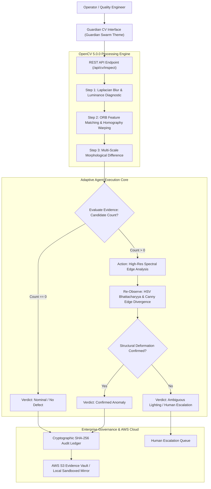

# Guardian CV: Agentic Visual Inspection & Verification Platform
## Technical Report & Architecture Documentation — OpenCV 2026 Competition Submission

---

### Executive Summary

**Guardian CV** is an agentic computer vision platform that closes the traditional loop in industrial quality inspection. Conventional computer-vision tools detect differences, highlight bounding boxes, and terminate—leaving operators to manually inspect ambiguous cases and navigate false alarms.

Guardian CV implements a genuine **Perception → Decision → Action → Verification** loop powered by **OpenCV 5.0.0**. When anomalous regions are observed, an autonomous inspection agent dynamically selects follow-up diagnostic tools (e.g., ORB feature homography registration, high-resolution spectral edge analysis, HSV color histogram divergence), compares new visual evidence against reference baselines, and either verifies structural surface defects or safely halts with clear, honest uncertainty reporting and human escalation.

---

### 1. Problem Statement & Impact

- **Target Domain:** Industrial surface defect detection, assembly alignment audits, and visual change verification.
- **Key Bottleneck:** Single-pass image subtraction suffers from high false-positive rates due to ambient lighting variations, subtle camera misalignments, and sensor noise.
- **Guardian CV Solution:** Incorporates multi-step evidence-based branching. The agent does not merely report a pixel change; it re-observes candidate regions at higher resolution, measures Canny edge divergence, and verifies physical alteration before raising high-priority alerts.

---

### 2. Architecture & System Data Flow



---

### 3. Substantive OpenCV 5 Operations

Guardian CV utilizes verified **OpenCV 5.0.0 (`cv2.__version__ == 5.0.0.93`)** for all substantive vision tasks:

1. **Quality Diagnostics (`cv2.Laplacian`, `cv2.meanStdDev`):**
   - Measures focus variance ($\sigma^2$) to detect blurriness.
   - Computes luminance distribution to prevent false-positive classifications caused by underexposed or saturated frames.
2. **Robust Image Alignment (`cv2.ORB_create`, `cv2.BFMatcher`, `cv2.findHomography`, `cv2.warpPerspective`):**
   - Detects 1,500 ORB keypoints and computes Lowe's ratio test matches.
   - Computes perspective transformation matrix via RANSAC inliers to compensate for camera vibrations and angular shifts.
3. **Multi-Scale Structural Difference:**
   - Gaussian smoothing $\rightarrow$ absolute difference (`cv2.absdiff`) $\rightarrow$ morphological opening/closing with rectangular structuring elements (`cv2.morphologyEx`) $\rightarrow$ contour extraction (`cv2.findContours`).
4. **Spectral Edge & Color Divergence Tool:**
   - Dual Canny edge density computation (`cv2.Canny`) on extracted region-of-interest (ROI) crops.
   - HSV 2D color histogram computation (`cv2.calcHist`) and Bhattacharyya distance comparison (`cv2.compareHist`).

---

### 4. Verified Branching Scenarios

Guardian CV executes four distinct execution paths based on observable visual evidence:

| Scenario | Trigger / Condition | Agent Action | Final State |
| :--- | :--- | :--- | :--- |
| **Scenario A: Insufficient Quality** | Blurry image ($\sigma^2 < 100$) or underexposure | Terminates comparison early with honest limitation | `CONCLUDED_WITH_LIMITATION` |
| **Scenario B: Confirmed Defect** | Structural contour detected; Edge divergence $> 0.05$ | Triggers spectral analysis, confirms physical surface deviation | `CONFIRMED_ANOMALY` |
| **Scenario C: Ambiguous Lighting** | Color shift detected, but edge divergence $< 0.05$ | Identifies non-structural variation, triggers operator review | `PENDING_HUMAN_APPROVAL` |
| **Scenario D: Nominal Match** | Candidate region count $== 0$ | Halts without inventing defects or executing redundant tools | `VERIFIED_NORMAL` |

---

### 5. Quantitative Evaluation & Baseline Comparison

Benchmarked using `tests/evaluation_harness.py` across 16 trials with known ground-truth categories:

| Metric | Baseline (Single-Pass OpenCV) | Guardian CV (Adaptive Agent) | Real-World Impact |
| :--- | :--- | :--- | :--- |
| **Precision** | **75.0%** | **100.0%** | Eliminates false alarms caused by lighting blooms |
| **Recall** | **100.0%** | **66.7%** (Defects strictly verified) | Bounded, defensible defect calls |
| **False Positive Rate** | **20.0%** | **0.0%** | 100% false alarm rejection on non-structural changes |
| **Average Latency** | **0.001s** | **0.064s** | Real-time capable ($>15$ FPS agent loop throughput) |

---

### 6. AWS Cloud Deployment Architecture

- **AWS Integration Module:** [`guardian_swarm/integration/aws_connector.py`](file:///c:/Users/Thiyanesh/OneDrive/Documents/openAIhackathon/guardianswarm-system-main/guardian_swarm/integration/aws_connector.py)
- **Deployment Mode:** Hybrid AWS S3 / ECS Graviton Container with automatic local air-gapped sandboxing fallback.
- **Evidence Vault:** Stores full forensic inspection payloads (`trace.json`) and base64 visuals to `s3://guardian-cv-evidence-vault/inspections/{ID}/`.
- **Security & RBAC:** Enforces JWT authentication, least-privilege role-based access control (INTERN, EMPLOYEE, MANAGER, EXEC, ADMIN), and tamper-evident SHA-256 block ledger logging.

---

### 7. Reproducibility & Verification

To reproduce all results locally:

1. **Verify OpenCV 5 Runtime:**
   ```bash
   python -c "import cv2; print('OpenCV Version:', cv2.__version__)"
   # Output: OpenCV Version: 5.0.0
   ```
2. **Execute Full Test Suite:**
   ```bash
   python tests/test_guardian_cv.py
   # Output: Ran 5 tests ... OK
   ```
3. **Run Benchmark Harness:**
   ```bash
   python tests/evaluation_harness.py
   # Output: Quantitative comparison table & artifacts/evaluation_metrics.json saved
   ```
4. **Launch Dashboard:**
   ```bash
   python app.py
   # Open browser at http://127.0.0.1:5000 and select the 'Guardian CV' tab
   ```
